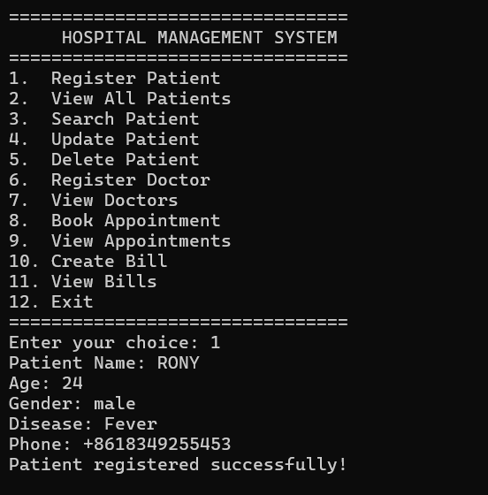
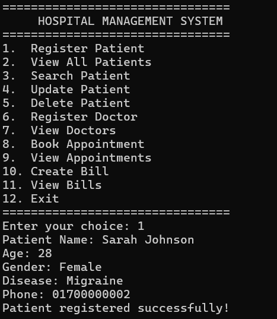
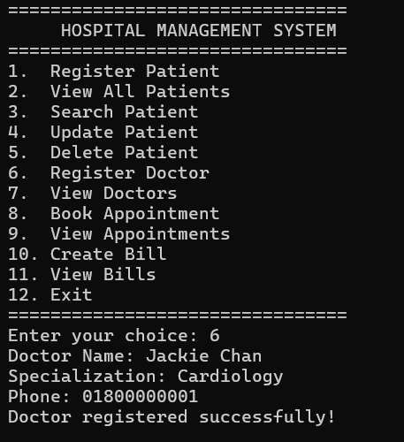
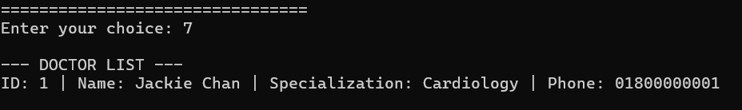
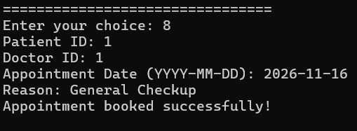
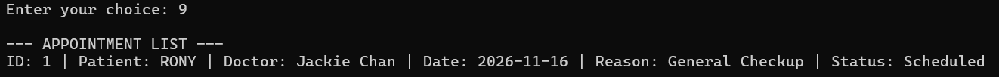
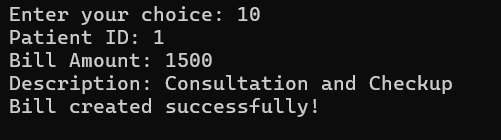
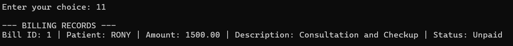

# Hospital Management System

A Java-based Hospital Management System developed using Java 21 and SQLite. The application manages patient records, doctors, appointments and billing information.

## Technologies Used
- Java 21
- SQLite
- JDBC
- SQL
- PowerShell

## Features

### Patient Management
- Register new patients
- View all patients
- Search patients by ID
- Update patient information
- Delete patient records

### Doctor Management
- Register doctors
- View doctor information
- Store medical specializations

### Appointment Management
- Book appointments
- View appointment records
- Link patients with doctors
- Track appointment status

### Billing Management
- Create patient bills
- View billing records
- Track payment status

## Database Design

The application uses four SQLite tables:

| Table | Purpose |
|---|---|
| patients | Patient information |
| doctors | Doctor information |
| appointments | Appointment records |
| bills | Billing information |

## Project Structure

- src/ - Java source code
- database/ - SQL schema
- lib/ - SQLite JDBC driver
- screenshots/ - Application screenshots
- report/ - Project report

## Application Screenshots

### 1. Patient Registration

### 2. Patient Registration - Second Example

### 3. Doctor Registration

### 4. Doctor List

### 5. Appointment Booking

### 6. Appointment List

### 7. Bill Creation

### 8. Billing Records

## How to Run

Compile:

javac -cp "lib/*" -d out src/HospitalManagementSystem.java

Run:

java -cp "out;lib/*" HospitalManagementSystem

## Author

Rony60031

GitHub: https://github.com/Rony60031
